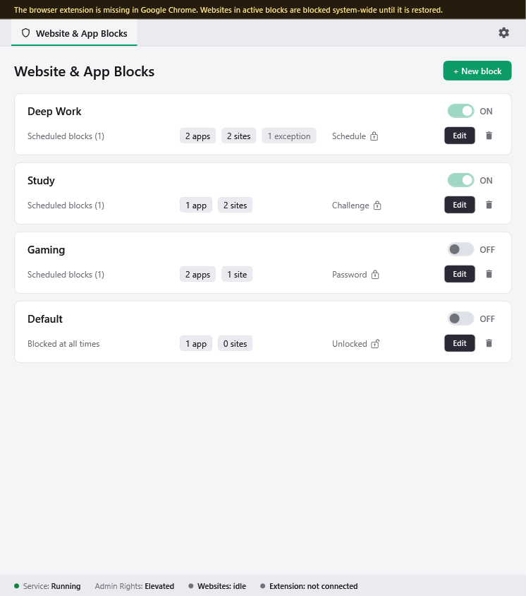
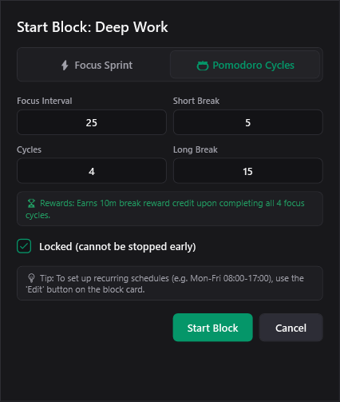
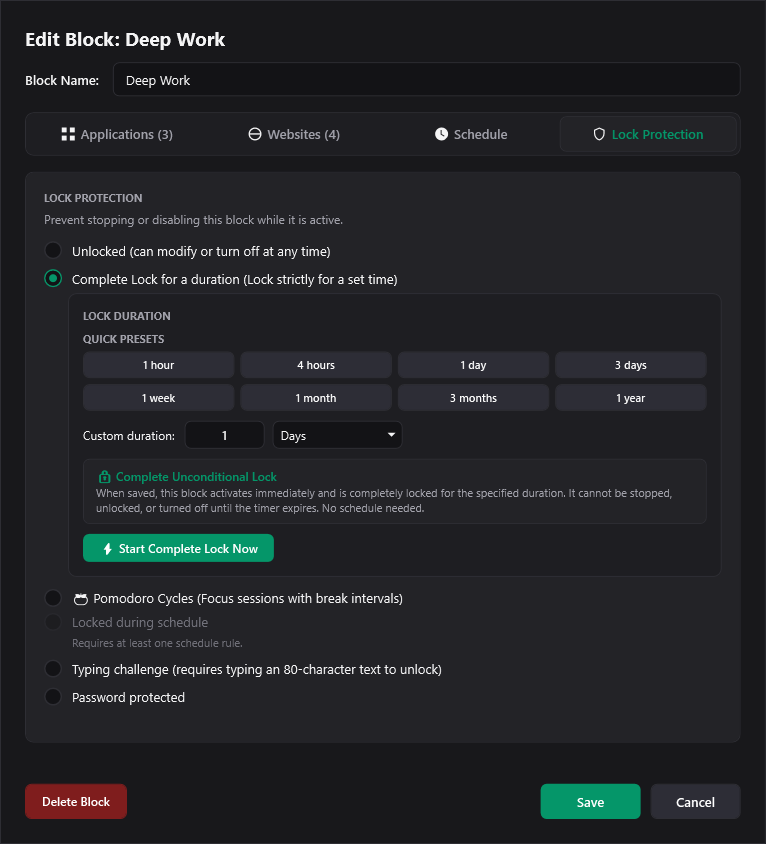
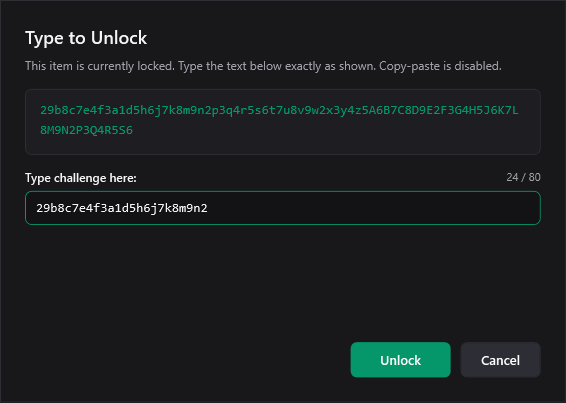
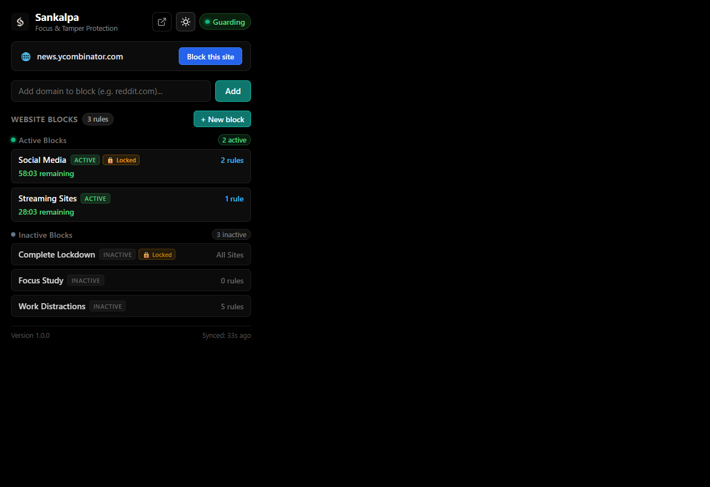

# Sankalpa (संकल्प)

<p align="center">
  
</p>

<p align="center">
  <strong>Tamper-resistant focus, website, and application blocker for Windows.</strong><br />
  Reclaim your digital time with unbreakable focus sessions, scheduled blocks, and deep-work protections.
</p>

<p align="center">
  <a href="https://github.com/virexnocturne/Sankalpa/releases/latest"></a>
  
  
  
  <a href="licenses/"></a>
</p>

---

<p align="center">
  
</p>

---

## Table of Contents
- [Download & Quick Start](#-download--quick-start)
- [How It Works](#-how-it-works-architecture)
- [Showcase & Key Features](#-showcase--key-features)
  - [1. Distraction-Free Themes](#1-distraction-free-themes)
  - [2. Multi-Target Blocklists (Websites & Apps)](#2-multi-target-blocklists-websites--apps)
  - [3. Focus Schedules & Timers](#3-focus-schedules--timers)
  - [4. Tamper-Proof Lock Protections](#4-tamper-proof-lock-protections)
  - [5. Companion Browser Extension](#5-companion-browser-extension)
- [Privacy Guarantee](#-privacy-guarantee)
- [Security Architecture & Hardening](#-security-architecture--hardening)
- [Isolated Simulation Test Suite](#-isolated-simulation-test-suite)
- [Command Line Interface (CLI)](#-command-line-interface-cli)
- [Building from Source](#-building-from-source)

---

## 🚀 Download & Quick Start

### 1. Download the Windows Installer
Download the latest one-click setup wizard from the official GitHub release:

👉 **[Download Sankalpa-Setup-1.0.0.exe](https://github.com/virexnocturne/Sankalpa/releases/download/v1.0.0/Sankalpa-Setup-1.0.0.exe)**

| File | Size | SHA-256 Checksum |
| :--- | :--- | :--- |
| `Sankalpa-Setup-1.0.0.exe` | ~81 MB | `1404027B274CC148E7AF984A9758EC8726CC0FE1456D2E0D5D5BE0946C2FCA60` |

### 2. Run the Setup Wizard
1. Double-click **`Sankalpa-Setup-1.0.0.exe`**.
2. When Windows User Account Control (UAC) prompts, click **Yes**. (Administrator elevation is required **once** during installation so the installer can register the tamper-resistant background service).
3. Follow the wizard steps to complete installation. Sankalpa will automatically start in the background.

> **Note on Windows SmartScreen**: Because this is a fresh open-source release, Windows Defender SmartScreen may display *"Windows protected your PC"*. Simply click **More info** → **Run anyway**.

### 3. Install the Browser Companion (Recommended)
For zero-latency website blocking and InPrivate protection, download **`sankalpa-extension-v1.0.0.zip`** from the [v1.0.0 Release](https://github.com/virexnocturne/Sankalpa/releases/tag/v1.0.0) or install via the Chrome Web Store:
1. Open your browser extension manager (`chrome://extensions`, `edge://extensions`, or `about:debugging` in Firefox).
2. Enable **Developer mode** (top-right toggle).
3. Drag and drop the unzipped extension folder into the browser window.
4. Enable **"Allow in Incognito / InPrivate"** in extension details so focus rules cannot be bypassed.

---

## ⚙️ How It Works (Architecture)

Sankalpa is engineered with a **dual-layer protection model** that separates user interface controls from system-level enforcement:

```
┌─────────────────────────────────────────────────────────────────┐
│                    User Experience Layer                        │
│                                                                 │
│   ┌───────────────────────────┐     ┌───────────────────────┐   │
│   │   Sankalpa Desktop UI     │     │   Browser Companion   │   │
│   │     (Sankalpa.exe)        │     │  (Chrome/Edge/Firefox)│   │
│   └─────────────┬─────────────┘     └───────────┬───────────┘   │
└─────────────────┼───────────────────────────────┼───────────────┘
                  │                               │ Standard I/O
                  │ Named Pipe IPC                │ NativeMessaging
┌─────────────────┼───────────────────────────────┼───────────────┐
│                 │                               │               │
│                 ▼                               ▼               │
│        ┌─────────────────────────────────────────────────┐      │
│        │        Native Messaging Bridge                  │      │
│        │        (Blocker.NativeHost.exe)                 │      │
│        └────────────────────────┬────────────────────────┘      │
│                                 │ Named Pipe IPC                │
│                                 ▼                               │
│        ┌─────────────────────────────────────────────────┐      │
│        │       Sankalpa Enforcer Service                 │      │
│        │         (Blocker.Service.exe)                   │      │
│        │       * Runs as LocalSystem                     │      │
│        │       * Auto-Restart Crash Watchdog             │      │
│        └────┬─────────────────────────────┬──────────────┘      │
│             │                             │                     │
│             ▼                             ▼                     │
│    System Hosts File              Process Termination           │
│   & Local DNS Redirection          & App Blacklisting           │
│                                                                 │
│                     Enforcement Core Layer                      │
└─────────────────────────────────────────────────────────────────┘
```

1. **Sankalpa Desktop UI (`Sankalpa.exe`)**: A lightweight WPF application running with standard user privileges. You configure block profiles, customize themes, set schedules, and trigger focus timers.
2. **Tamper-Resistant Windows Service (`Blocker.Service.exe`)**: Runs with `SYSTEM` privileges in the background. It monitors active processes, updates local DNS/hosts redirection, and maintains monotonic session timers across reboots. Even if you close the UI, the service remains vigilant.
3. **Auto-Restart Watchdog**: If the service process is abnormally killed, Windows Service Control Manager automatically restarts it with zero delay (`sc failure restart/0/restart/0`).
4. **Native Messaging Bridge (`Blocker.NativeHost.exe`)**: Translates extension events directly to the background service and dispatches native Windows Shell Action Center toast notifications even when the desktop UI window is closed.

---

## 🎨 Showcase & Key Features

### 1. Distraction-Free Themes
Sankalpa offers three master themes designed for extended focus: **Black** (ultra-deep OLED), **White** (clean high-contrast daylight), and **Grey** (soft neutral slate). All three support 6 dynamic accents (Emerald, Indigo, Violet, Amber, Rose, Slate).

<p align="center">
  
  
</p>

---

### 2. Multi-Target Blocklists (Websites & Apps)
Create independent block profiles for different contexts (e.g. *Deep Work*, *Writing*, *No Social Media*).

- **Websites Tab**: Block specific root domains, subdomains, or wildcard patterns with instant redirect to a focus hold screen.
- **Apps Tab**: Scan installed Windows desktop programs or running processes, and prevent distraction apps (games, Discord, media players) from launching.

<p align="center">
  
  
</p>

---

### 3. Focus Schedules & Timers
- **Weekly Schedules**: Define active time blocks for weekdays and weekends (e.g., Mon–Fri 9:00 AM – 5:00 PM).
- **Pomodoro Sessions**: Start an on-demand session with customizable focus durations and break intervals.

<p align="center">
  
  
</p>

---

### 4. Tamper-Proof Lock Protections
To prevent impulse unlocking when your willpower dips, Sankalpa provides three enforceable lock mechanisms:

| Lock Mode | Description |
| :--- | :--- |
| **Random Typing Challenge** | Requires typing a complex multi-line randomized phrase with zero typos before unlocking. |
| **Strict Password Lock** | Requires entering an emergency unlock password set during profile creation. |
| **Timed Lockout** | Completely forbids unlocking until the scheduled timer runs down to zero. |

<p align="center">
  
  
</p>

---

### 5. Companion Browser Extension
The Sankalpa extension communicates directly with the local service to provide in-browser countdown widgets and instant domain enforcement across Chrome, Brave, Edge, and Firefox.

<p align="center">
  
</p>

---

## 🔒 Privacy Guarantee

- **100% Offline & Local**: Sankalpa does not connect to external servers or send telemetry data.
- **No Cloud Accounts**: No logins, email registrations, or remote tracking.
- **Your Data Remains Yours**: All profiles, rules, and local statistics are stored exclusively on your hard drive in `%LocalAppData%\Sankalpa\data\`.

Review our complete [Privacy Policy](packaging/browser-extension/PRIVACY_POLICY.md).

---

## 🛡️ Security Architecture & Hardening

Sankalpa incorporates defense-in-depth protections designed to ensure focus blocks cannot be tampered with or accidentally bypassed:

1. **Named Pipe Client Authentication & Emergency Unlock Authorization**:
   - The named pipe server (`\\.\pipe\BlockerControl`) extracts the caller's Windows token via impersonation (`stream.RunAsClient(...)`).
   - Default-deny policy: unauthenticated callers are rejected from all commands except `PING`.
   - `EMERGENCYUNLOCK` is strictly restricted to elevated Administrators and `LocalSystem`, or legitimate standard users who possess an administrative emergency recovery token (`EMERGENCY_UNLOCK`) in the protected installation directory.
   - Read the complete audit and matrix in [Command Authorization Documentation](docs/COMMAND_AUTHORIZATION.md).
2. **Heartbeat Replay & Stale Cache Mitigation**:
   - The native messaging bridge (`Blocker.NativeHost.exe`) explicitly flags cached payloads with `"cached": true` and `"serviceConnected": false` when the background service is unavailable.
   - The browser extension only refreshes heartbeat timestamps on fresh live payloads.
   - During extended service outages, the extension's intended 10-minute fail-open timeout triggers reliably, preventing permanent lockouts while immediately resuming enforcement upon service reconnection.
3. **Robust Singleton Mutex Failure Handling**:
   - Service singleton mutex management correctly handles `AbandonedMutexException` (recognizing thread ownership), prevents duplicate instances from launching upon unexpected OS exceptions, and releases the handle only when acquired.
4. **Verified Service Lockdown & DACL Enforcement**:
   - Eliminates fragile shell wrappers in favor of direct `sc.exe` execution with timeout detection and exit-code validation.
   - Post-execution security descriptor query (`sc.exe sdshow`) verifies that the lockdown SDDL is actively applied before setting `IsServiceLockedDown`.
5. **Continuous Security Auditing**:
   - Comprehensive matrix covering all 24 exposed IPC commands with caller privilege classification and lock enforcement rules.

---

## 🧪 Isolated Simulation Test Suite

Sankalpa includes a reproducible, zero-impact simulation environment that exercises all security fixes, IPC authorization rules, mutex contention, and extension fail-open timeouts without modifying host DNS, Windows services, or system hosts files:

```powershell
# 1. Setup the isolated test environment
.\tests\Simulation\setup.ps1

# 2. Run the full security regression, simulation, and extension suites
.\tests\Simulation\run-tests.ps1

# 3. Clean up disposable simulation fixtures
.\tests\Simulation\cleanup.ps1
```

For full details on the 12 simulation scenarios and mocking strategy, see the [Simulation Environment Documentation](tests/Simulation/README.md).

---

## 💻 Command Line Interface (CLI)

Sankalpa includes a dedicated command-line utility (`sankalpa-cli.exe`) for automation and power users:

```powershell
# Show system status and active blocking profiles
sankalpa-cli status

# List all configured profiles
sankalpa-cli list

# Manually start a profile session for 45 minutes
sankalpa-cli start --profile "Deep Work" --duration 45m

# Stop an active session (if not locked)
sankalpa-cli stop --profile "Deep Work"
```

---

## 🛠️ Building from Source

### Prerequisites
- **Windows 10 / 11 (64-bit)**
- **.NET 8.0 SDK** ([Download](https://dotnet.microsoft.com/download/dotnet/8.0))
- **Inno Setup 6+** (`winget install JRSoftware.InnoSetup`)

### Steps
1. Clone the repository:
   ```powershell
   git clone https://github.com/virexnocturne/Sankalpa.git
   cd Sankalpa
   ```
2. Build the solution:
   ```powershell
   dotnet build Blocker.sln -c Release
   ```
3. Build the 1-click Windows installer:
   ```powershell
   powershell -ExecutionPolicy Bypass -File packaging\windows-installer\build-installer.ps1 -Version "1.0.0"
   ```
   The compiled installer is generated in `packaging\dist\Sankalpa-Setup-1.0.0.exe`.

4. Package the companion extension:
   ```powershell
   powershell -ExecutionPolicy Bypass -File packaging\browser-extension\package-extension.ps1
   ```

---

## 📜 Licenses
- Fonts: **Familjen Grotesk** & **IBM Plex** (SIL Open Font License 1.1)
- Icons: **Lucide Icons** (ISC License)
- See details in the [`licenses/`](licenses/) directory.
