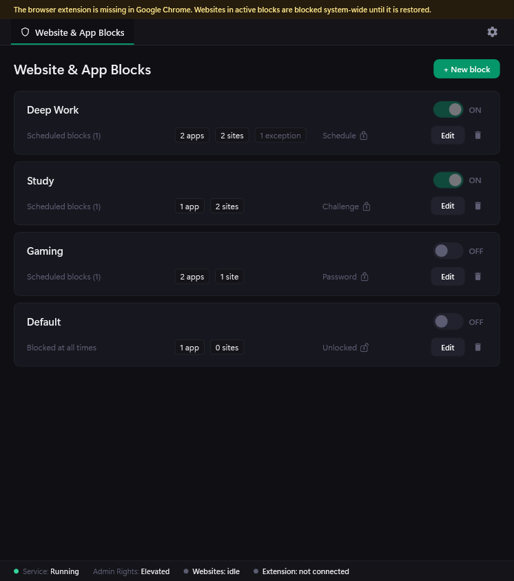
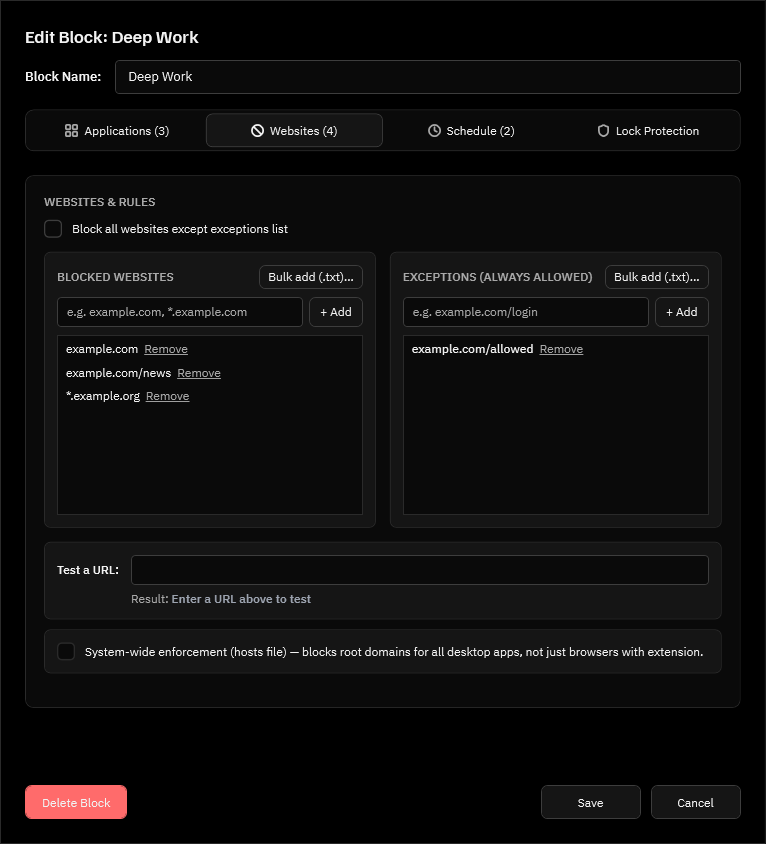
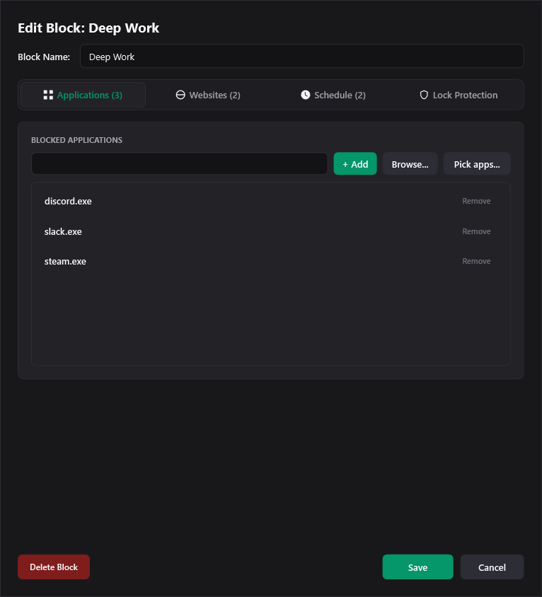
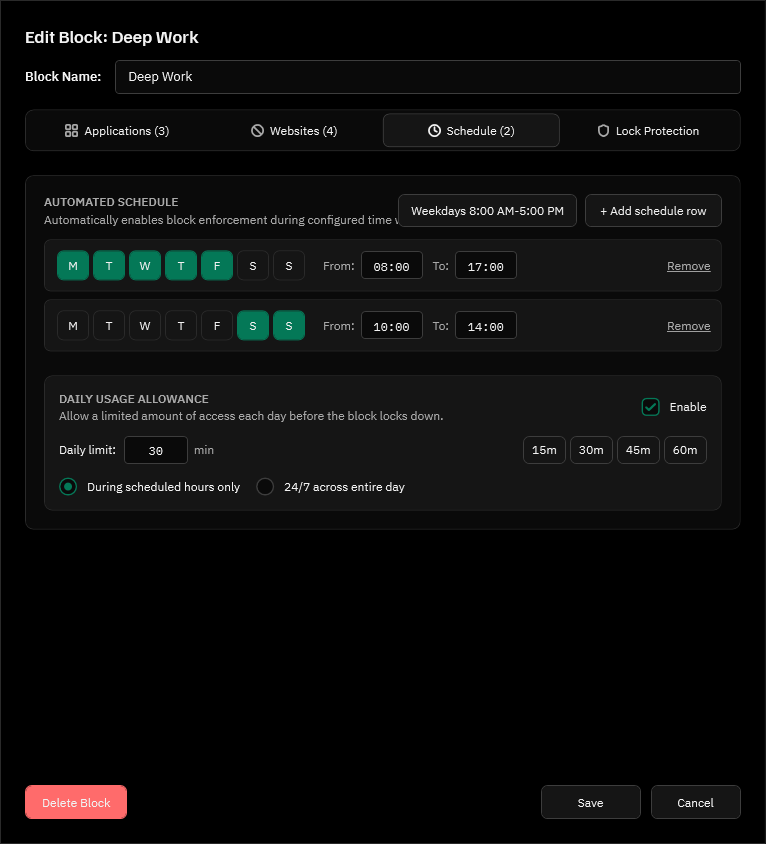
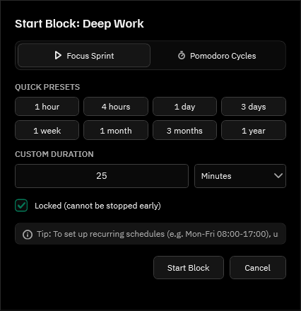
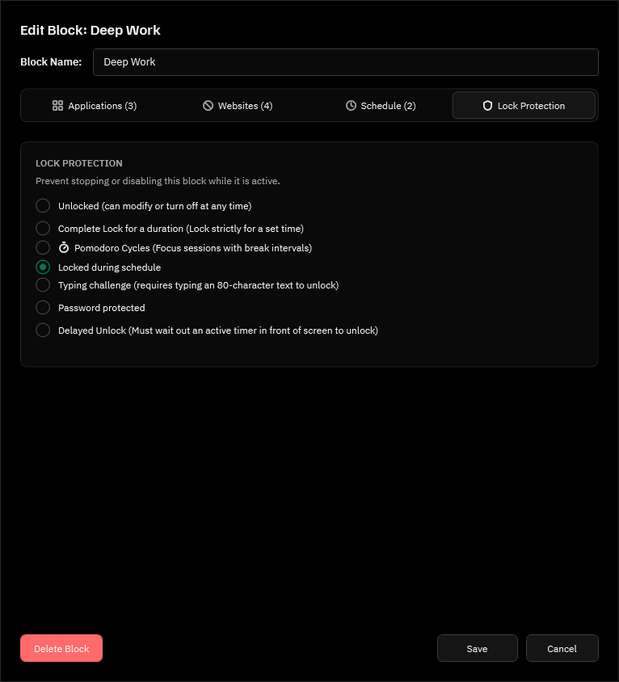
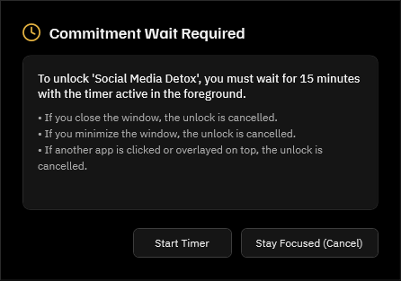
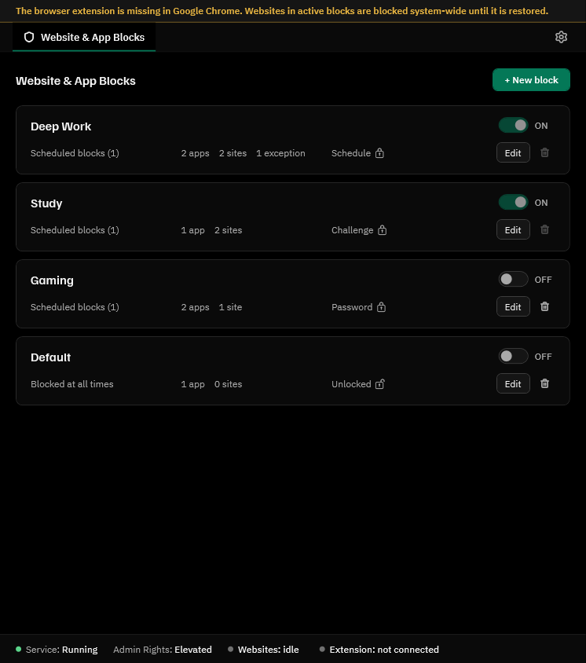
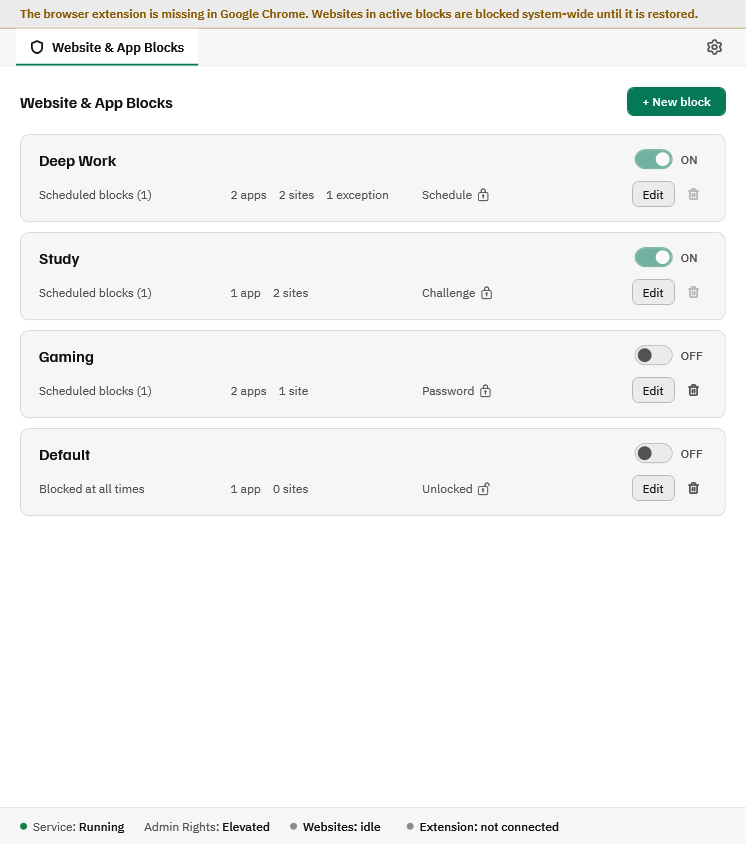
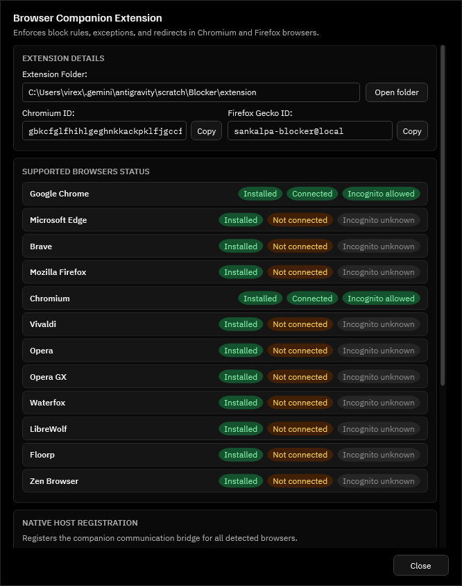

# Sankalpa (संकल्प)

<p align="center">
  
</p>

<p align="center">
  <strong>Tamper-resistant focus, website, and application blocker for Windows.</strong><br />
  Reclaim your digital focus with unbreakable focus sessions, automatic schedule lockouts, delayed unlocks, and deep anti-tamper protections.
</p>

<p align="center">
  <a href="https://github.com/virexnocturne/Sankalpa/releases/latest"></a>
  
  
  
  <a href="licenses/"></a>
</p>

---

<p align="center">
  
</p>

---

## 🌟 What's New in v1.3.6 (Zen UI Performance, CLI Meditation Controls & Audio UX)

- ⚡ **Zen Mode WinEvent Filter & Coalescing**: Narrowed window hook listeners to 5 discrete event types with lock-free trailing-edge coalescing, completely eliminating UI-thread message spikes.
- 🪟 **Idempotent Mini-HUD & Non-Blocking App Minimization**: Topmost re-assertion is rate-limited and focus changes only trigger on state transitions. Minimized allowed applications use `SWP_ASYNCWINDOWPOS` and `ShowWindowAsync` to avoid hung window stalls.
- 🚀 **Dedicated MTA Background Throttler Worker**: Offloaded process enumeration, COM audio session queries, 25-second working set trims, and crash-journal persistence away from the UI thread onto a background worker.
- 🔐 **Asynchronous Single-Verify Password Unlock**: PBKDF2 (100k iterations) verification runs asynchronously off the UI thread once per attempt with fail-closed validation and prompt suppression.
- 💻 **Complete CLI Meditation Suite (`sankalpa-cli`)**: Introduced full CLI commands for starting, stopping, querying, and scheduling meditation sessions, requesting delayed unlock tokens, and viewing live blocking audit events.
- 🎵 **M3U / M3U8 Playlist Import & Soundscape Sync**: Added local playlist parser hardened against UNC/SMB relays and directory traversal, with an active event bus synchronizing custom tracks across the UI without application restarts.
- 🛡️ **Emergency Schedule Bypass & Profile Editing**: Emergency unlock disables recurring schedules to prevent re-lock loops, and unlocked profiles can de-escalate lock modes back to None without re-entering passwords.

## 🌟 What's New in v1.3.5 (Cold Launch Fast Path, Helper Immunity & Path Pinning)

- ⚡ **Cold Launch Fast Path & Snapshot Elimination (Bugs 12 & 14)**: Deleted desktop-wide window enumerations on non-running candidate processes, eliminating 5-7 second stalls on cold launches. Throttled fallback discovery scans to every 2 seconds.
- 🛡️ **OS System Helper Immunity via Directory Pinning (Bugs 12 & 14)**: Added `SystemHelperGuard` exempting `RuntimeBroker`, `ctfmon`, `TextInputHost`, `sihost`, `fontdrvhost`, and `ApplicationFrameHost` from suspension with strict path canonicalization, restoring instant keyboard typing, IME input, and packaged app activation.
- 🔄 **Dynamic App Switching, Cancellation & Mini-HUD Feedback (Bugs 13 & 14)**: Switched to `CancellationTokenSource` cooperative cancellation to prevent dropped clicks during rapid app switching. Bounded watchdog grace period strictly to 4 seconds, restored minimized windows while preserving maximized states, and added status progress and tap-to-retry to Mini-HUD.
- 🧹 **Session-Spawned Child Cleanup (Bug 13)**: Retained `SafeProcessHandle` and tracked creation timestamps to terminate only session-spawned children descended from allowed apps on session exit, preventing flood of queued Claude Code terminals and CLI shells.
- 🎯 **Executable Path Pinning (CLI Collision Fix & Spoofing Guard)**: Transmits pinned installation roots to the background service to ensure CLI tools sharing GUI app names (e.g. `~/.local/bin/claude.exe`) cannot bypass lockdown, and prevents imposter executables in user folders or `%TEMP%` from claiming system binary protection.

## 🌟 What's New in v1.3.4 (Performance, App Picker Guard & System Hardening)

- ⚡ **High-Performance Process Suspension & Launching**: Cached session IDs, cached own-process names, skipped syscalls for already-suspended PIDs, and asynchronous background window discovery so launch of allowed apps (like Microsoft Edge and Notepad++) happens in milliseconds without UI stalls.
- 🛡️ **Child Process Directory Exemption**: Allowed apps can spawn child worker processes (e.g., Edge sandboxed renderer/gpu processes) only when they reside inside the allowed parent application's installation folder.
- 🔒 **Self-Binary Exclusion in App Picker (Bug 4)**: Sankalpa binaries (`Sankalpa.exe`, `Blocker.Service.exe`, `Blocker.NativeHost.exe`, `sankalpa-cli.exe`) are filtered from the "Pick apps..." dialog and strictly validated to prevent accidental self-blocking.
- 🪟 **Windows Search Grid Icon & AUMID Fix (Bug 1)**: Registered top-level Start Menu program shortcut `{autoprograms}\Sankalpa.lnk` with embedded PE icon index 0 and ensured AUMID registrations target `Sankalpa.exe` rather than the native host.
- 🎵 **Resilient Audio Asset Handling (Bug 5)**: Prevented application crashes if ambient sound files (`rain.wav`, etc.) are deleted from AppData, handling missing media gracefully and marking dispatcher exceptions as handled.
- ⌨️ **Unhindered Emergency Escape Chord**: Upgraded keyboard hook thread priority with a 300 ms jitter grace period and redundant background polling to ensure emergency unlock (`Ctrl+Shift+Alt+Esc`) never drops keypresses.

## 🌟 What's New in v1.3.3 (In-House Zen Snipper & System Ergonomics)

- ✂️ **In-House Zen Screen Snipper (`Ctrl + Shift + S` / `PrintScreen`)**: Instant, hardware-accelerated screen capture with quad-slice canvas masking (`MaskTop`, `MaskBottom`, `MaskLeft`, `MaskRight`), zero WPF geometry tessellation overhead, and direct 32bpp RGB buffer locking.
- 📐 **Zero-Zoom 1:1 Rendering & Mixed DPI Support**: High-precision snipping across multi-monitor displays with zero scale drift using `Stretch.Fill` and Win32 `SWP_NOSIZE`.
- 📁 **Seamless Notes Image Integration**: Captures are immediately converted and referenced as markdown attachments (``) inside active reflection notes and Obsidian vault backups.
- 🔎 **Robust AppPathResolver**: Non-intrusive executable discovery across registry, system PATH, and Start Menu with `UAC_InputIndicatorOverlayWnd` filtering for smooth whitelisted app floating.
- 🔕 **Windows Focus Assist & Notification Sync**: Automatically quiets Windows toasts and distraction banners during meditation sessions.
- 🎨 **Polished Dialog Ergonomics**: Upgraded dialog interfaces with uniform dark themes, centered modals, and intuitive `Enter`/`Esc` key handling.

---

## 🌟 What's New in v1.3.1 (Massive Bug Patch & Rigor Enforcement)

- 🛡️ **Ironclad Lockdown Watchdog**: Minimizing or dragging an allowed app title bar no longer exposes background windows—`ZenShieldWindow` acts as an underlying Zen backdrop at `HWND_BOTTOM` with a 500ms watchdog and a pinned Mini-HUD **"Return to Zen Focus"** button.
- 🚫 **Wishlist Conflict Prevention**: Apps present in active or scheduled Block Profiles cannot be wishlisted during meditation mode and are flagged as `(Blocked by Block Profile)`.
- 🛑 **Task View Gesture & Hook Hardening**: Suppressed three-finger swipe-up (`Task View` / `MultitaskingViewFrame`) and `Win+Tab`/`Alt+Tab` while permitting `Win+Shift+S` for screenshots.
- 🔒 **Meditation Rigor Enforced**: Typing Challenge strictly validates sentence text; Password Protection requires setup and validates PBKDF2/SHA-256 salted hashes; Daily Schedules auto-trigger on time; durations persist across restarts.
- 📝 **Persistent Notes Vault**: Notes are automatically saved to local JSON storage (`%LOCALAPPDATA%\Sankalpa\notes\active_notes.json`) across restarts; caret drift on `#` tags fixed; in-edit-mode screenshot previews added.
- ⌨️ **Expanded Global Shortcuts**: `Ctrl + Shift + M` (Meditation), `Ctrl + Alt + M` (Mute), `Ctrl + Shift + U` (Configure), `Ctrl + N` (New Quick Note), `Ctrl + Shift + N` (Notes Drawer), `Esc` (Dismiss dialogs).

---

## 🌟 What's New in v1.3.0

- 🧘 **Meditation & Computer Lockdown Mode**: Fullscreen, multi-monitor Zen Shield with adaptive monospace timer, gentle breathing ring animation, and tamper-resistant lockdown (DACL hardening, WinKey/Alt+Tab/Ctrl+Esc suppression, boot recovery).
- 📝 **Obsidian-Style Notes Collection & Slide-Out Drawer**: Card-based reflection notes with `#` headings, interactive `- [ ]` task checkboxes that toggle in real-time, right-edge vertical `"NOTES"` drawer handle, and 3-way flexible Markdown export (Session Bundle, Obsidian Vault files, Master Journal).
- 🌧️ **Offline Ambient Sound Engine**: 4 high-quality 16-bit PCM soundscapes (`Rain`, `Library`, `Forest`, `Singing Bowls`) looping seamlessly with smooth volume fades, positioned in a compact top-left pill (`🌧 Rain ▾`).
- 💊 **Whitelisted App Mini-HUD & Quick Notes Overlay**: Floating HUD pill when working inside allowed apps with a 1-click `[ 📝 Notes ]` action and `Alt + N` quick notes overlay.
- ⌨️ **Global Application Hotkeys**: `Ctrl + B` (New Block), `Ctrl + S` (Settings), `Ctrl + M` (Meditation), `Alt + N` (Quick Notes).

---

## Table of Contents
- [Download & Quick Start](#-download--quick-start)
- [How It Works (Architecture)](#-how-it-works-architecture)
- [Comprehensive Features](#-comprehensive-features)
  - [1. Multi-Target Blocklists (Websites & Apps)](#1-multi-target-blocklists-websites--apps)
  - [2. Focus Schedules & Daily Allowances](#2-focus-schedules--daily-allowances)
  - [3. Unbreakable Lock Protections](#3-unbreakable-lock-protections)
  - [4. Distraction-Free Themes](#4-distraction-free-themes)
  - [5. Companion Browser Extension](#5-companion-browser-extension)
- [Security Architecture & Anti-Tamper Hardening](#-security-architecture--anti-tamper-hardening)
- [Privacy Guarantee](#-privacy-guarantee)
- [Command Line Interface (CLI)](#-command-line-interface-cli)
- [Testing & Verification](#-testing--verification)
- [Building from Source](#-building-from-source)
- [Licenses](#-licenses)

---

## 🚀 Download & Quick Start

### 1. Download Latest Release (v1.3.1)
Download the installer or standalone release directly from [GitHub Releases](https://github.com/virexnocturne/Sankalpa/releases/latest):

| File | Type | Size | SHA-256 Checksum |
| :--- | :--- | :--- | :--- |
| **[`Sankalpa-Setup-1.3.0.exe`](https://github.com/virexnocturne/Sankalpa/releases/download/v1.3.0/Sankalpa-Setup-1.3.0.exe)** | **Recommended Installer** | 144 MB | `912E3E86F916F4B555CBA1A3A552D4B90933B9EF2D0D4EDA8B79817E519110AE` |
| **[`Sankalpa.exe`](https://github.com/virexnocturne/Sankalpa/releases/download/v1.3.0/Sankalpa.exe)** | Portable Standalone | 165 MB | `E2706007EF3AC8DBE1EFD757D93D0B2550C67706A191B81785DF7764891AA722` |
| **[`sankalpa-extension-v1.3.0.zip`](https://github.com/virexnocturne/Sankalpa/releases/download/v1.3.0/sankalpa-extension-v1.3.0.zip)** | Companion Extension | 39 KB | `07E64CB84B5976E8E0F2A3EC61473DCEE6EA7AA575F6C64DFF46382BD664FCE4` |

### 2. Run the Setup Wizard
1. Run **`Sankalpa-Setup-1.3.0.exe`**.
2. Click **Yes** when Windows User Account Control (UAC) prompts (Administrator rights are needed **once** during installation to register the tamper-resistant background service).
3. The setup automatically installs the desktop application, background enforcement service, native messaging bridge, and desktop shortcuts.

> **Note on Windows SmartScreen**: Windows Defender SmartScreen may display *"Windows protected your PC"* on fresh releases. Click **More info** → **Run anyway**.

### 3. Install Companion Extension
For instantaneous website blocking and incognito protection:
1. Open your browser's extension manager:
   - Chrome / Brave / Opera: `chrome://extensions`
   - Microsoft Edge: `edge://extensions`
   - Mozilla Firefox: `about:debugging`
2. Enable **Developer mode** toggle.
3. Unzip **`sankalpa-extension-v1.2.0.zip`** and click **Load unpacked** (or click **"Open folder"** from the desktop app's status bar).
4. In extension details, enable **"Allow in Incognito / InPrivate"**.

---

## ⚙️ How It Works (Architecture)

Sankalpa is built with a **dual-layer protection model** that cleanly isolates user configuration from system-level enforcement:

```
┌─────────────────────────────────────────────────────────────────┐
│                    User Experience Layer                        │
│                                                                 │
│   ┌───────────────────────────┐     ┌───────────────────────┐   │
│   │   Sankalpa Desktop UI     │     │   Browser Companion   │   │
│   │     (Sankalpa.exe)        │     │  (Chrome/Edge/Firefox)│   │
│   └─────────────┬─────────────┘     └───────────┬───────────┘   │
└─────────────────┼───────────────────────────────┼───────────────┘
                  │                               │ Standard I/O
                  │ Named Pipe IPC                │ NativeMessaging
┌─────────────────┼───────────────────────────────┼───────────────┐
│                 │                               │               │
│                 ▼                               ▼               │
│        ┌─────────────────────────────────────────────────┐      │
│        │        Native Messaging Bridge                  │      │
│        │        (Blocker.NativeHost.exe)                 │      │
│        └────────────────────────┬────────────────────────┘      │
│                                 │ Named Pipe IPC                │
│                                 ▼                               │
│        ┌─────────────────────────────────────────────────┐      │
│        │       Sankalpa Enforcer Service                 │      │
│        │         (Blocker.Service.exe)                   │      │
│        │       * Runs as LocalSystem                     │      │
│        │       * Auto-Restart Crash Watchdog             │      │
│        └────┬─────────────────────────────┬──────────────┘      │
│             │                             │                     │
│             ▼                             ▼                     │
│    System Hosts File              Process Termination           │
│   & Local DNS Redirection          & App Blacklisting           │
│                                                                 │
│                     Enforcement Core Layer                      │
└─────────────────────────────────────────────────────────────────┘
```

1. **Desktop Client (`Sankalpa.exe`)**: Modern WPF application with responsive design, instant search, inline profile renaming, and dark/light themes.
2. **Background Enforcer Service (`Blocker.Service.exe`)**: Runs continuously under the `NT AUTHORITY\SYSTEM` account. Maintains timers across reboots, kills unauthorized apps, and applies system DNS/hosts redirection.
3. **Native Messaging Host (`Blocker.NativeHost.exe`)**: Dispatches real-time extension heartbeats and Windows Shell Action Center toast alerts even when the UI is closed.
4. **Auto-Restart Watchdog**: Windows Service Control Manager automatically restarts the service with 0ms delay if terminated (`sc failure restart/0/restart/0`).

---

## 🎯 Comprehensive Features

### 1. Multi-Target Blocklists (Websites & Apps)
Create customized, context-specific block profiles (e.g. *Deep Work*, *Study Mode*, *Social Media Detoxing*):

- **Websites Tab**: Block specific domains (e.g., `youtube.com`, `reddit.com`), entire categories, or enable **Block All Websites** with custom whitelist exceptions.
- **Applications Tab**: Scan running processes and installed Windows desktop applications. Distraction apps (Steam, Discord, Telegram, games) are immediately terminated if launched during active sessions.

<p align="center">
  
  
</p>

---

### 2. Focus Schedules & Daily Allowances
- **Automated Recurring Schedules**: Configure multi-day time windows (e.g., Mon–Fri 08:00–17:00). When the scheduled time arrives, enforcement activates and locks automatically.
- **Daily Usage Allowance**: Grant yourself a limited amount of daily recreation time (e.g. 30 mins) before the profile enters complete lockdown.
- **Pomodoro & Focus Timers**: Start on-demand focus intervals with custom durations and optional short/long break rewards.

<p align="center">
  
  
</p>

---

### 3. Unbreakable Lock Protections
To prevent giving in to temptation, Sankalpa provides multiple unyielding lock modes:

| Lock Mode | Behavior |
| :--- | :--- |
| **Complete / Timed Lock** | Completely locks the block. Cannot be stopped, edited, or turned off until the timer expires. |
| **Schedule Lock (`Schedule 🔒`)** | Automatically locks the block for the entire duration of configured schedule windows. Toggle switch is disabled. |
| **Delayed Unlock (`Delay ⏳`)** | Requires waiting out an active 15m, 30m, 1h, or 2h on-screen countdown timer to prevent impulsive unlocks. |
| **Random Typing Challenge** | Requires correctly typing a complex, randomized 80-character text with zero typos. |
| **Password Protection** | Requires entering a secure emergency password set when configuring the profile. |

<p align="center">
  
  
</p>

---

### 4. Distraction-Free Themes
Sankalpa includes four tailored themes designed for clarity and eye comfort:
- **Obsidian Black**: Deep OLED black for zero glare during night sessions.
- **Dark**: Balanced slate dark mode.
- **Grey**: Softer neutral contrast.
- **Light**: High-contrast daylight mode.
All themes support 6 vibrant accent palettes (Emerald, Indigo, Violet, Amber, Rose, Slate).

<p align="center">
  
  
</p>

---

### 5. Companion Browser Extension
- Compatible with **Chrome**, **Microsoft Edge**, **Brave**, **Firefox**, **Vivaldi**, and **Opera**.
- Zero-latency page redirection to an inspiring focus hold screen.
- Real-time countdown timer directly in the browser toolbar.
- Incognito/InPrivate tamper detection with autonomous browser termination fallback.

<p align="center">
  
  
</p>

---

## 🛡️ Security Architecture & Anti-Tamper Hardening

1. **Strict Uninstall Protection (`UninstallGuard`)**:
   - `sankalpa-cli check-uninstall` inspects both the live service and offline SQLite database/system hosts file.
   - If an active block session, schedule, or locked profile is active, Windows Settings / Add-Remove Programs (`unins000.exe`) and standalone uninstallers strictly refuse uninstallation.
2. **Autonomous Browser Termination**:
   - Browsers opened in Incognito without extension permission or unextended secondary browsers are detected, granted a 60-second grace countdown with Windows toast alerts, and automatically terminated if compliance is not met.
3. **Named Pipe Client Authentication**:
   - Default-deny IPC server (`\\.\pipe\BlockerControl`) verifies caller tokens via Windows Impersonation (`stream.RunAsClient`).
   - Administrative commands and emergency unlocks require Administrator or `LocalSystem` credentials.
4. **Monotonic Timers & Reboot Immunity**:
   - Session timers and schedule states are stored in an encrypted/system-protected local SQLite database. Changing system clock or rebooting will not bypass active sessions.

---

## 🔒 Privacy Guarantee

- **100% Offline & Local**: Zero network telemetry, zero analytical trackers, zero third-party calls.
- **No Accounts Required**: No email, cloud login, or subscriptions.
- **Your Data Remains on Your Machine**: All profiles, rules, and logs reside locally in `%LocalAppData%\Sankalpa\data\`.
- Complete [Privacy Policy](packaging/browser-extension/PRIVACY_POLICY.md).

---

## 💻 Command Line Interface (CLI)

Sankalpa includes `sankalpa-cli.exe` in the application directory for automation, scripting, and headless control:

```powershell
# Check current protection status and active blocks
sankalpa-cli status

# Start a profile manually for 45 minutes
sankalpa-cli start --profile "Deep Work" --duration 45m

# Stop an active session (if unlocked)
sankalpa-cli stop --profile "Deep Work"

# 🧘 Meditation & Lockdown Mode
sankalpa-cli meditation status
sankalpa-cli meditation start --duration 20m --apps "spotify.exe,notion.exe" --sound rain
sankalpa-cli meditation stop --notes "Great focus session"
sankalpa-cli meditation note --text "Quick thought captured"
sankalpa-cli meditation history --limit 5
sankalpa-cli meditation schedule list
sankalpa-cli meditation schedule add --time 15:00 --days Mon,Tue,Wed,Thu,Fri --duration 20m

# ⌛ Delayed Unlock Management
sankalpa-cli delayed-unlock request --name "Deep Work"
sankalpa-cli delayed-unlock cancel --name "Deep Work" --token <token>

# 🛡️ DNS Protection & Challenge
sankalpa-cli dns
sankalpa-cli dns challenge
sankalpa-cli lock-dns --mode Timer --duration 86400
sankalpa-cli unlock-dns --challenge-text <text>

# 📁 Profiles & Web Rules
sankalpa-cli profile list
sankalpa-cli profile rename --name "Old Profile" --new-name "New Profile"
sankalpa-cli webrules

# 🔒 Security Audit & Uninstallation Check
sankalpa-cli events --limit 10
sankalpa-cli check-uninstall
```

---

## 🧪 Testing & Verification

Sankalpa contains a comprehensive automated test suite with **over 660 unit, integration, and security tests**:

```powershell
# Run the complete test suite
dotnet test Blocker.sln

# Run isolated security simulation scenarios
.\tests\Simulation\setup.ps1
.\tests\Simulation\run-tests.ps1
.\tests\Simulation\cleanup.ps1
```

---

## 🛠️ Building from Source

### Prerequisites
- **Windows 10 / 11 (64-bit)**
- **.NET 8.0 SDK** ([Download](https://dotnet.microsoft.com/download/dotnet/8.0))
- **Inno Setup 6+** (`winget install JRSoftware.InnoSetup`)

### Steps
1. Clone the repository:
   ```powershell
   git clone https://github.com/virexnocturne/Sankalpa.git
   cd Sankalpa
   ```
2. Build the solution:
   ```powershell
   dotnet build Blocker.sln -c Release
   ```
3. Compile the Inno Setup installer:
   ```powershell
   powershell -ExecutionPolicy Bypass -File packaging\windows-installer\build-installer.ps1 -Version "1.2.0"
   ```
   The installer executable will be generated at `packaging\dist\Sankalpa-Setup-1.2.0.exe`.

---

## 📜 Licenses
- Fonts: **Familjen Grotesk** & **IBM Plex** (SIL Open Font License 1.1)
- Icons: **Lucide Icons** (ISC License)
- See details in the [`licenses/`](licenses/) directory.
